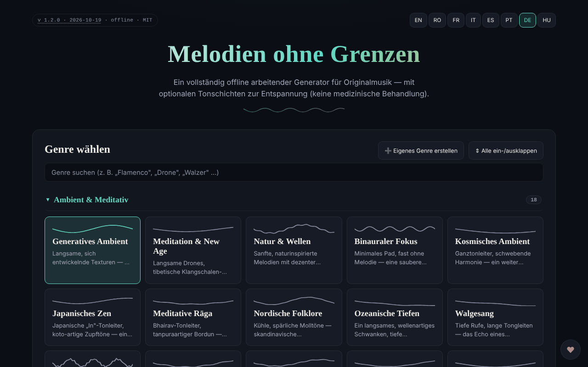

# Borderless Melodies

[English](README.md) · [Română](README.ro.md) · [Français](README.fr.md) · [Italiano](README.it.md) · [Español](README.es.md) · [Português](README.pt.md) · **Deutsch** · [Magyar](README.hu.md)

**Version:** 1.2.2 · **Zuletzt aktualisiert:** 2026-10-22

Oberflächensprachen: **Română, English, Français, Italiano, Español, Português (PT), Deutsch, Magyar**

Generator originaler Musik, die algorithmisch im Browser erzeugt wird, mit optionalen Tonschichten zur Entspannung („Relaxation waves“).

**Online:** https://chiuta.github.io/BorderlessMelodies/

## Was es ist

Borderless Melodies („Melodien ohne Grenzen“) ist eine einzige HTML-Datei, die Musik in Echtzeit über Web Audio synthetisiert: ohne Samples oder Aufnahmen, nur prozedurale Synthese. Du wählst ein Genre, einen Seed und eine Dauer, und die Anwendung komponiert Melodie, Begleitung und Bass, die du anhören oder exportieren kannst.

## Funktionen

- Genreauswahl aus einer Liste und Editor für eigene Genres („Create custom genre“: Tonleiter, Progression, Taktart 4/4, 3/4, 5/4, 7/4, Tempo, Leadmelodie, Pad/Akkorde, Bass, Textur, Filter, Hall, erweiterte Optionen); Genres werden in „My Genres“ gespeichert und können exportiert/importiert werden (JSON).
- Komposition: Seed (mit „Randomize“), Tempo, „Variety & arc“, Duration (2, 5, 10, 20 Min. oder Endlosschleife), „Regenerate“.
- „Relaxation waves“: Zusatzschicht in den Modi Pure tone, Binaural oder Isochronic, mit Trägerfrequenz, Schwebungsfrequenz und Mischung. Die Anwendung weist darauf hin, dass sie nur zur Entspannung und nicht als medizinische Behandlung angeboten werden, und enthält Warnhinweise (Epilepsie, Schwangerschaft, Autofahren).
- „Human voice“: wortlose Gesangsschicht, per Formantensynthese erzeugt, mit mehreren Charakteren (Kind, Jugendlicher, Erwachsener, Senior, melodisch-robotisch).
- „Gong & conch“: synthetisierter Gong und Muschelhorn, manuell oder automatisch zu Beginn/Ende auslösbar.
- **Automatische Abschaltung (Schlaf):** Nach 15, 30, 45, 60 oder 90 Minuten ab Play sinkt die Lautstärke innerhalb von 15 Sekunden, und die Wiedergabe stoppt (der Countdown läuft auch in der Pause weiter; Stop bricht ihn ab); der Wert ist im JSON-Export/-Import der Einstellungen enthalten (`sleepMin`).
- Wiedergabe mit Play/Stop, Lautstärke und Vollbild-Fraktalvisualisierung (2D/3D).
- Audio-Export als WAV oder FLAC (1–20 Min.), Export/Import der Einstellungen (JSON), generatives Cover (PNG/WebP/JPEG), an den Seed gebunden, WebM-Videoexport der Visualisierung.
- Oberfläche in 8 Sprachen: EN, RO, FR, IT, ES, PT, DE, HU.

## Neue Funktionen (v1.1.0)

- **Gespeicherte Sitzungen**: Genre, Seed, Tempo, Dauer, Timer und Dauer der Ausblendung werden unter einem Namen gespeichert (maximal 30; derselbe Name, ohne Beachtung der Groß-/Kleinschreibung, überschreibt). Laden und Löschen aus der Liste; lokal gespeichert und in der `.fff.json`-Kopie enthalten. Beschädigte Daten in `localStorage` ergeben eine leere Liste, ohne Fehler.
- **QR-Code / Link**: Die aktuelle Sitzung wird zu einem QR-Code (und einem Link mit `#…`), den eine andere Instanz aus einem Bild, eingefügtem Text oder einem Link lesen kann. Ein geöffneter Link **startet den Ton nicht** automatisch. Werte außerhalb der Grenzen werden begrenzt, unbekannte Genres abgelehnt; eigene Genres werden nicht geteilt.
- **Konfigurierbare Ausblendung bei der automatischen Abschaltung** (standardmäßig 15 s, 1 Min., 5 Min., 10 Min.): Die Lautstärke nimmt in den letzten Sekunden des Timers schrittweise ab, in den Tests in Echtzeit überprüft.
- **Kit**: Transparenz und `.fff.json`-Kopie (`core, label, bundle, qr`).
- **Sprachen und Übersetzungen**: Die neuen Texte liegen in den 8 Sprachen der Anwendung vor (RO, EN, FR, IT, ES, PT, DE, HU). Die Übersetzungen FR/IT/ES/PT/DE/HU sind automatisch und **nicht von Muttersprachlern überprüft**; der Kit-Dialog hat 8 Sprachen.

## Bedienungsanleitung

1. Wähle die Sprache mit den Schaltflächen EN / RO / FR / IT / ES / PT / DE / HU.
2. Wähle ein Genre (oder „Create custom genre“, konfiguriere es und drücke „Save“).
3. Stelle Seed (oder 🎲 Randomize), Tempo und Duration ein.
4. Optional: Aktiviere „Relaxation waves“, „Human voice“ oder den Gong/das Muschelhorn.
5. Drücke ▶ Play; die Leertaste startet/stoppt die Wiedergabe (wenn der Fokus nicht auf einem Feld oder einer Schaltfläche liegt).
6. In der Fraktalvisualisierung: `+` / `=` vergrößert, `-` / `_` verkleinert, `0` setzt zurück, Esc schließt.
7. Wähle unter „Export“ die Dauer und das Format (WAV oder FLAC) und drücke „Export audio“.
8. Um die Konfiguration zu behalten: „Export settings (JSON)“ und später „Import settings“; ebenso „Export my genres“ / „Import genres“.
9. „Generate cover“ erzeugt das Cover, danach „Export PNG“ (oder WebP/JPEG). „Record video“ nimmt in Echtzeit auf (ein 20-Minuten-Clip dauert 20 Minuten).

## Datenschutz und Netzwerk

- Das „Grenzenlos“-Kit (`fff-kit`, Module `core, label, bundle, qr`) ist in `index.html` eingefügt: Es stellt keine Netzwerkanfragen. Der Dialog „Transparenz“ (Klick auf die Version) zeigt das deklarierte Netzwerk (0 externe Anfragen), die Schlüssel in `localStorage`, den SHA-256 der Datei und bietet eine `.fff.json`-Sicherungskopie (optional mit Passwort verschlüsselt, AES-GCM). QR-Codes werden lokal erzeugt und gelesen; das Lesen erfolgt nur aus einem vom Nutzer gewählten Bild, ohne Kamera.

- Die Anwendung verwendet weder `localStorage`, `sessionStorage` noch IndexedDB: Zwischen den Sitzungen wird nichts behalten; gespeichert wird nur über die exportierten Dateien.
- Sie stellt keine Netzwerkanfragen (kein `fetch`, keine CDNs oder externen Skripte); die Seite hat eine restriktive CSP-Richtlinie (`default-src 'none'`, Skript nur per `sha256`-Hash erlaubt, ohne `'unsafe-inline'` für Skripte; Inline-Stil, Bilder und Audio nur `data:`/`blob:`). Sie enthält nur Links, die per Klick geöffnet werden, zu trom.tf, Buy Me a Coffee.

## Hinweis

Informativer/erfahrungsbezogener Inhalt. Die Schicht „Relaxation waves“ (reine, binaurale, isochrone Töne) wird nur zur Entspannung angeboten, ist keine medizinische Behandlung und ersetzt keine ärztliche Beratung; die wissenschaftliche Evidenz zu den Wirkungen binauraler/isochroner Rhythmen ist begrenzt. Nicht empfohlen bei Epilepsie, anderen neurologischen Erkrankungen oder Schwangerschaft ohne Zustimmung des Arztes; nicht beim Autofahren hören; bei Unwohlsein abbrechen; niedrige Lautstärke verwenden. Der Hinweis erscheint in der Anwendung (Bereich „Relaxation waves“) und in der Fußzeile der Seite.

## Lokal / offline ausführen

Lade `index.html` herunter und öffne sie im Browser; sie funktioniert vollständig ohne Internet.

## Lizenz

MIT — siehe Datei LICENSE

## Audit

2026-10-10: Es wurde überprüft, dass der Code kein `fetch`, XHR, WebSocket oder externe Ressourcen enthält (0 Netzwerkanfragen im Browser) und kein lokaler Speicher verwendet wird. Die Seite hat keine CSP-Richtlinie (Meta). Korrigiert: zugängliche Namen für Schalter/Auswahlfelder, Kontrast, Warnhinweis in der Fußzeile.

## Autor

Alexio — Alexandru-Ionuț Chiuță, Kontakt: alexio@trom.tf

## Verlauf / Changelog

- 1.2.2 — 2026-10-22: Die Beschriftungen für Screenreader (Schließen, Beenden, Wiedergabe/Pause, Mini-Player, Zoom, gespeicherte Sitzungen, Cover- und Videoformat, Stopp, Unterstützen, 2D/3D) sind jetzt übersetzt und folgen dem Sprachwechsel.
- 1.2.1 — 2026-10-22: **Korrektur**: der medizinische Hinweis, der Tooltip des Vollbild-Visualisierers und die ARIA-Beschriftung der oberen Leiste sind jetzt in alle acht Sprachen übersetzt.
- 1.1.0 — 2026-10-14: gespeicherte Sitzungen, QR/Link für die Sitzung, konfigurierbare Ausblendung, „Grenzenlos“-Kit. Tests: `tests/fff-r8.test.mjs`.
- **1.0.4 — 2026-10-12:** Die Version und das Datum der letzten Aktualisierung werden in der Anwendung angezeigt
- **1.0.3 — 11. Oktober 2026:** automatisches helles Design (`prefers-color-scheme: light`; das dunkle Design bleibt Standard) und Druckstylesheet; in Chromium mit hellem und dunklem Schema überprüft (axe 0 Verstöße bei 1280×800 und 360×740) und mit tatsächlicher Wiedergabe (nach Play wechselt der Status auf „Playing“, der Audiokontext startet bei der Nutzergeste).
- **1.0.2 — 11. Oktober 2026:** automatische Abschaltung (Schlaf) mit 15 s Ausblendung, enthalten in den exportierten/importierten Einstellungen (unbekannte Werte werden beim Import ignoriert); die Bezeichnungen der Solfeggio-Frequenzen werden jetzt in der Sprache der Oberfläche angezeigt (zuvor erschienen sie in FR/IT/ES/PT/DE auf Englisch); CSP mit `sha256`-Hash für das Skript (ohne `'unsafe-inline'` in `script-src`); die neuen Texte liegen in den 7 Sprachen vor; mit aktiver CSP getestet (0 Fehler) und axe-core 0 Verstöße bei 1280×800 und 360×740.

- **1.0.1 — 11. Oktober 2026:** Der Audio-Export ist besser reproduzierbar: Rauschen, Hall, Gong und Muschelhorn verwenden beim Export einen aus dem Seed abgeleiteten Pseudozufallsgenerator (zuvor verwendeten sie `Math.random`). Verbleibende Grenze: Zwei Exporte mit denselben Einstellungen unterscheiden sich bei ~0,05 % der Samples noch um ±1 LSB (gemessen bei 1 Min. Audio), sind also nicht bitgenau identisch, wegen der Gleitkommaarithmetik der Audio-Engine des Browsers.
- Unter den „Solfeggio“-Frequenzen erschien ein Hinweis in 7 Sprachen: Die Bezeichnungen (Befreiung, Regeneration, Harmonie …) sind traditionelle/esoterische Zuschreibungen ohne wissenschaftlichen Beleg; ebenso sind die Namen der Gehirnwellen orientierend.
- Sicherheit/Barrierefreiheit: Ein CSP-Meta wurde hinzugefügt (`default-src 'none'`), `region`-Landmarken für die obere Leiste und den Mini-Player; axe-core 0 Verstöße bei 1280×800 und 360×740. Das Format der Einstellungsdatei (JSON) bleibt `version: 1.0` zur Importkompatibilität.
