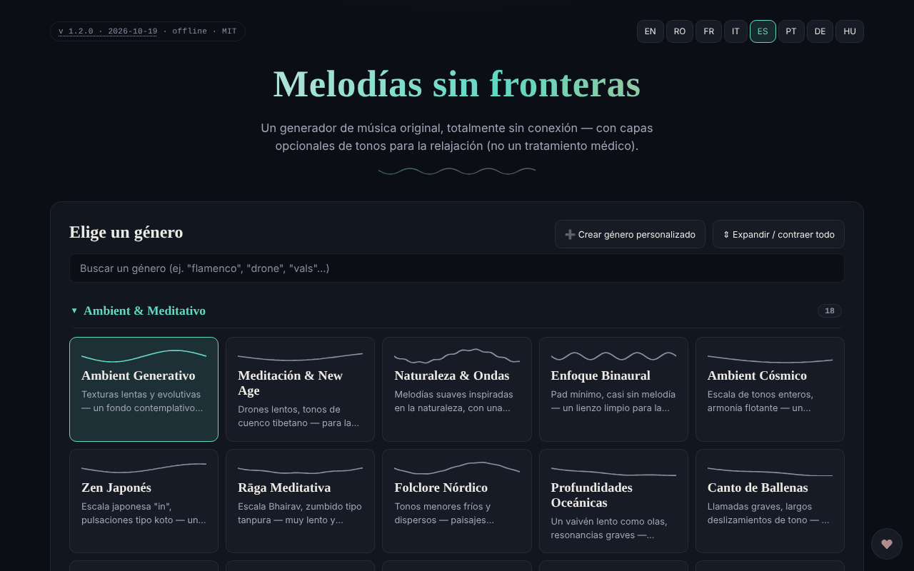

# Borderless Melodies

[English](README.md) · [Română](README.ro.md) · [Français](README.fr.md) · [Italiano](README.it.md) · **Español** · [Português](README.pt.md) · [Deutsch](README.de.md) · [Magyar](README.hu.md)

**Versión:** 1.2.2 · **Última actualización:** 2026-10-22

Idiomas de la interfaz: **Română, English, Français, Italiano, Español, Português (PT), Deutsch, Magyar**

Generador de música original, creada algorítmicamente en el navegador, con capas opcionales de tonos para la relajación («Relaxation waves»).

**En línea:** https://chiuta.github.io/BorderlessMelodies/

## Qué es

Borderless Melodies («Melodías sin fronteras») es un único archivo HTML que sintetiza música en tiempo real mediante Web Audio: sin muestras ni grabaciones, solo síntesis procedimental. Eliges un género, una semilla (seed) y una duración, y la aplicación compone la melodía, el acompañamiento y el bajo, que puedes escuchar o exportar.

## Funciones

- Elección de género de una lista y editor de géneros propios («Create custom genre»: escala, progresión, compás 4/4, 3/4, 5/4, 7/4, tempo, melodía principal, pad/acordes, bajo, textura, filtro, reverberación, opciones avanzadas); los géneros se guardan en «My Genres» y pueden exportarse/importarse (JSON).
- Composición: Seed (con «Randomize»), Tempo, «Variety & arc», Duration (2, 5, 10, 20 min o bucle continuo), «Regenerate».
- «Relaxation waves»: capa auxiliar en los modos Pure tone, Binaural o Isochronic, con frecuencia portadora, frecuencia de batido y mezcla. La aplicación aclara que se ofrecen solo para la relajación, no como tratamiento médico, y contiene advertencias (epilepsia, embarazo, conducción).
- «Human voice»: capa vocal sin palabras, sintetizada mediante formantes, con varios caracteres (niño, adolescente, adulto, mayor, robótico melodioso).
- «Gong & conch»: gong y caracola sintetizados, que pueden activarse manualmente o automáticamente al inicio/al final.
- **Parada automática (sueño):** a los 15, 30, 45, 60 o 90 minutos de pulsar Play, el volumen baja en 15 segundos y la reproducción se detiene (la cuenta atrás continúa en pausa; Stop la cancela); el valor se incluye en la exportación/importación de ajustes JSON (`sleepMin`).
- Reproducción con Play/Stop, volumen y visualizador fractal a pantalla completa (2D/3D).
- Exportación de audio WAV o FLAC (1-20 min), exportación/importación de ajustes (JSON), portada generativa (PNG/WebP/JPEG) ligada a la semilla, exportación de vídeo WebM del visualizador.
- Interfaz en 8 idiomas: EN, RO, FR, IT, ES, PT, DE, HU.

## Nuevas funciones (v1.1.0)

- **Sesiones guardadas**: el género, la semilla, el tempo, la duración, el temporizador y la duración del fundido se conservan bajo un nombre (máximo 30; el mismo nombre, sin distinguir mayúsculas, sobrescribe). Carga y eliminación desde la lista; almacenadas localmente e incluidas en la copia `.fff.json`. Datos corruptos en `localStorage` dan una lista vacía, sin errores.
- **Código QR / enlace**: la sesión actual se convierte en un código QR (y un enlace con `#…`) que otra instancia puede leer desde una imagen, texto pegado o un enlace. Un enlace abierto **no inicia el sonido** automáticamente. Los valores fuera de rango se limitan, los géneros desconocidos se rechazan; los géneros personalizados no se comparten.
- **Fundido configurable en la parada automática** (15 s por defecto, 1 min, 5 min, 10 min): el volumen disminuye progresivamente en los últimos segundos del temporizador, verificado en tiempo real en las pruebas.
- **Kit**: Transparencia y copia `.fff.json` (`core, label, bundle, qr`).
- **Idiomas y traducciones**: los textos nuevos están en los 8 idiomas de la aplicación (RO, EN, FR, IT, ES, PT, DE, HU). Las traducciones FR/IT/ES/PT/DE/HU son automáticas y **no han sido verificadas por hablantes nativos**; el diálogo del kit tiene 8 idiomas.

## Manual de uso

1. Elige el idioma con los botones EN / RO / FR / IT / ES / PT / DE / HU.
2. Elige un género (o «Create custom genre», configúralo y pulsa «Save»).
3. Ajusta Seed (o 🎲 Randomize), Tempo y Duration.
4. Opcional: activa «Relaxation waves», «Human voice» o el gong/la caracola.
5. Pulsa ▶ Play; la barra espaciadora inicia/detiene la reproducción (cuando el foco no está en un campo o botón).
6. En el visualizador fractal: `+` / `=` acerca, `-` / `_` aleja, `0` restablece, Esc cierra.
7. En «Export» elige la duración y el formato (WAV o FLAC) y pulsa «Export audio».
8. Para conservar la configuración: «Export settings (JSON)» y, más tarde, «Import settings»; igualmente «Export my genres» / «Import genres».
9. «Generate cover» crea la portada, luego «Export PNG» (o WebP/JPEG). «Record video» graba en tiempo real (un clip de 20 min dura 20 min).

## Privacidad y red

- El kit «sin fronteras» (`fff-kit`, módulos `core, label, bundle, qr`) está pegado en `index.html`: no realiza solicitudes de red. El diálogo «Transparencia» (clic en la versión) muestra la red declarada (0 solicitudes externas), las claves de `localStorage`, el SHA-256 del archivo y ofrece una copia de seguridad `.fff.json` (opcionalmente cifrada con contraseña, AES-GCM). Los códigos QR se generan y se leen localmente; la lectura se hace solo desde una imagen elegida por el usuario, sin cámara.

- La aplicación no usa `localStorage`, `sessionStorage` ni IndexedDB: nada se conserva entre sesiones; solo guardas mediante los archivos exportados.
- No realiza solicitudes de red (no tiene `fetch`, CDN ni scripts externos); la página tiene una política CSP restrictiva (`default-src 'none'`, script permitido solo mediante hash `sha256`, sin `'unsafe-inline'` para los scripts; estilo en línea, imágenes y audio solo `data:`/`blob:`). Contiene únicamente enlaces, abiertos al hacer clic, hacia trom.tf, Buy Me a Coffee.

## Advertencia

Contenido informativo/experiencial. La capa «Relaxation waves» (tonos puros, binaurales, isocrónicos) se ofrece solo para la relajación, no es un tratamiento médico y no sustituye el consejo médico; las pruebas científicas sobre los efectos de los ritmos binaurales/isocrónicos son limitadas. No se recomienda en caso de epilepsia, otra afección neurológica o embarazo sin el consentimiento del médico; no escuches mientras conduces; detente si sientes malestar; usa un volumen bajo. La advertencia aparece en la aplicación (panel «Relaxation waves») y en el pie de la página.

## Ejecución local / sin conexión

Descarga `index.html` y ábrelo en el navegador; funciona completamente sin internet.

## Licencia

MIT — véase el archivo LICENSE

## Auditoría

2026-10-10: verificado que en el código no existen `fetch`, XHR, WebSocket ni recursos externos (0 solicitudes de red en el navegador) y que no se usa almacenamiento local. La página no tiene política CSP (meta). Corregidos: nombres accesibles para interruptores/selectores, contraste, nota de advertencia en el pie.

## Autor

Alexio — Alexandru-Ionuț Chiuță, contacto: alexio@trom.tf

## Historial / Changelog

- 1.2.2 — 2026-10-22: Las etiquetas para lectores de pantalla (cerrar, salir, reproducir/pausa, minirreproductor, zoom, sesiones guardadas, formato de portada y de vídeo, detener, apoyar, 2D/3D) ya están traducidas y se actualizan al cambiar de idioma.
- 1.2.1 — 2026-10-22: **corrección**: el aviso médico, la descripción emergente del visualizador de pantalla completa y la etiqueta ARIA de la barra superior ya están traducidos a los ocho idiomas.
- 1.1.0 — 2026-10-14: sesiones guardadas, QR/enlace para la sesión, fundido configurable, kit «sin fronteras». Pruebas: `tests/fff-r8.test.mjs`.
- **1.0.4 — 2026-10-12:** la versión y la fecha de la última actualización se muestran en la aplicación
- **1.0.3 — 11 de octubre de 2026:** tema claro automático (`prefers-color-scheme: light`; el tema oscuro sigue siendo el predeterminado) y hoja de estilo de impresión; verificado en Chromium con esquema claro y oscuro (axe 0 infracciones a 1280×800 y 360×740) y con reproducción efectiva (tras Play el estado pasa a «Playing», el contexto de audio arranca con el gesto del usuario).
- **1.0.2 — 11 de octubre de 2026:** parada automática (sueño) con fundido de 15 s, incluida en los ajustes exportados/importados (los valores desconocidos se ignoran al importar); las etiquetas de las frecuencias Solfeggio se muestran ahora en el idioma de la interfaz (antes aparecían en inglés en FR/IT/ES/PT/DE); CSP con hash `sha256` para el script (sin `'unsafe-inline'` en `script-src`); los textos nuevos están en los 7 idiomas; probado con CSP activa (0 errores) y axe-core 0 infracciones a 1280×800 y 360×740.

- **1.0.1 — 11 de octubre de 2026:** la exportación de audio es más reproducible: el ruido, la reverberación, el gong y la caracola usan en la exportación un generador pseudoaleatorio derivado de la semilla (antes usaban `Math.random`). Límite restante: dos exportaciones con los mismos ajustes aún difieren en ±1 LSB en ~0,05 % de las muestras (medido en 1 min de audio), por lo que no son idénticas bit a bit, debido a la aritmética de coma flotante del motor de audio del navegador.
- Bajo las frecuencias «Solfeggio» apareció una nota en 7 idiomas: las etiquetas (liberación, regeneración, armonía…) son atribuciones tradicionales/esotéricas, sin pruebas científicas; igualmente, los nombres de las ondas cerebrales son orientativos.
- Seguridad/accesibilidad: se añadió un meta CSP (`default-src 'none'`), hitos `region` para la barra superior y el minirreproductor; axe-core 0 infracciones a 1280×800 y 360×740. El formato del archivo de ajustes (JSON) sigue siendo `version: 1.0` por compatibilidad al importar.
