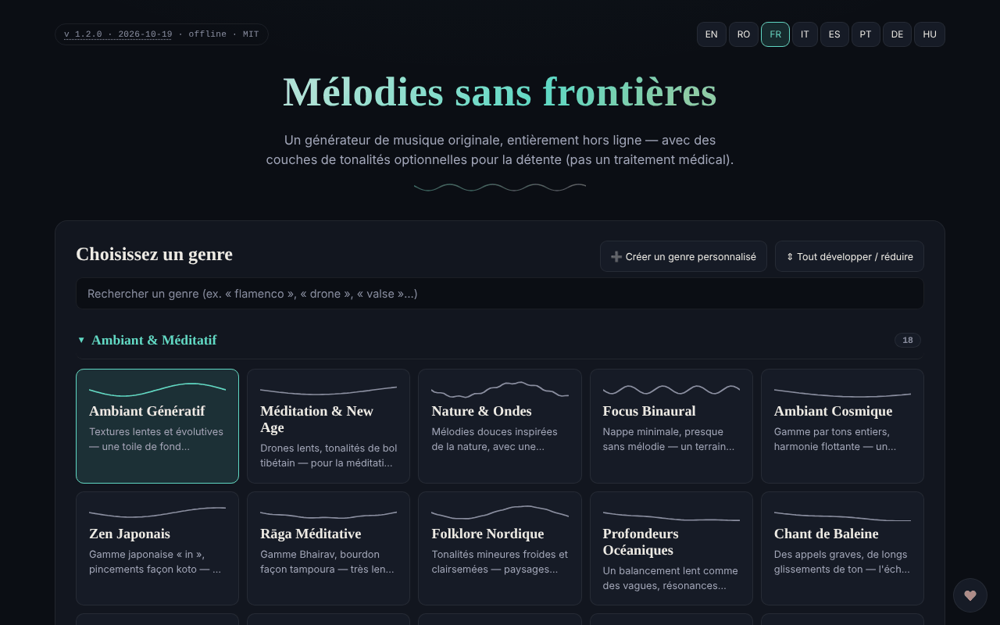

# Borderless Melodies

[English](README.md) · [Română](README.ro.md) · **Français** · [Italiano](README.it.md) · [Español](README.es.md) · [Português](README.pt.md) · [Deutsch](README.de.md) · [Magyar](README.hu.md)

**Version :** 1.2.4 · **Dernière mise à jour :** 2026-10-22

Langues de l'interface : **Română, English, Français, Italiano, Español, Português (PT), Deutsch, Magyar**

Générateur de musique originale, créée algorithmiquement dans le navigateur, avec des couches de tonalités facultatives pour la relaxation (« Relaxation waves »).

**En ligne :** https://chiuta.github.io/BorderlessMelodies/

## Qu'est-ce que c'est

Borderless Melodies (« Mélodies sans frontières ») est un fichier HTML unique qui synthétise de la musique en temps réel via Web Audio : ni échantillons ni enregistrements, uniquement de la synthèse procédurale. Vous choisissez un genre, une graine (seed) et une durée, et l'application compose la mélodie, l'accompagnement et la basse, que vous pouvez écouter ou exporter.

## Fonctions

- Choix du genre dans une liste et éditeur de genres personnalisés (« Create custom genre » : gamme, progression, mesure 4/4, 3/4, 5/4, 7/4, tempo, mélodie principale, pad/accords, basse, texture, filtre, réverbération, options avancées) ; les genres sont enregistrés dans « My Genres » et peuvent être exportés/importés (JSON).
- Composition : Seed (avec « Randomize »), Tempo, « Variety & arc », Duration (2, 5, 10, 20 min ou boucle continue), « Regenerate ».
- « Relaxation waves » : couche auxiliaire en modes Pure tone, Binaural ou Isochronic, avec fréquence porteuse, fréquence de battement et mixage. L'application précise qu'elles sont proposées uniquement pour la relaxation, et non comme traitement médical, et contient des avertissements (épilepsie, grossesse, conduite).
- « Human voice » : couche vocale sans paroles, synthétisée par formants, avec plusieurs caractères (enfant, adolescent, adulte, senior, robotique mélodieux).
- « Gong & conch » : gong et conque synthétisés, déclenchables manuellement ou automatiquement au début/à la fin.
- **Arrêt automatique (sommeil) :** après 15, 30, 45, 60 ou 90 minutes à partir de Play, le volume baisse en 15 secondes et la lecture s'arrête (le décompte continue en pause ; Stop l'annule) ; la valeur est incluse dans l'export/import JSON des réglages (`sleepMin`).
- Lecture avec Play/Stop, volume et visualiseur fractal plein écran (2D/3D).
- Export audio WAV ou FLAC (1-20 min), export/import des réglages (JSON), pochette générative (PNG/WebP/JPEG) liée à la graine, export vidéo WebM du visualiseur.
- Interface en 8 langues : EN, RO, FR, IT, ES, PT, DE, HU.

## Nouvelles fonctions (v1.1.0)

- **Sessions enregistrées** : le genre, la graine, le tempo, la durée, la minuterie et la durée du fondu sont conservés sous un nom (maximum 30 ; un même nom, sans distinction de casse, écrase l'existant). Chargement et suppression depuis la liste ; stockées localement et incluses dans la copie `.fff.json`. Des données corrompues dans `localStorage` donnent une liste vide, sans erreur.
- **Code QR / lien** : la session courante devient un code QR (et un lien avec `#…`) qu'une autre instance peut lire à partir d'une image, d'un texte collé ou d'un lien. Un lien ouvert **ne démarre pas le son** automatiquement. Les valeurs hors limites sont plafonnées, les genres inconnus rejetés ; les genres personnalisés ne sont pas partagés.
- **Fondu configurable à l'arrêt automatique** (15 s par défaut, 1 min, 5 min, 10 min) : le volume diminue progressivement durant les dernières secondes de la minuterie, vérifié en temps réel dans les tests.
- **Kit** : Transparence et copie `.fff.json` (`core, label, bundle, qr`).
- **Langues et traductions** : les nouveaux textes sont dans les 8 langues de l'application (RO, EN, FR, IT, ES, PT, DE, HU). Les traductions FR/IT/ES/PT/DE/HU sont automatiques et **non vérifiées par des locuteurs natifs** ; la boîte de dialogue du kit comporte 8 langues.

## Mode d'emploi

1. Choisissez la langue avec les boutons EN / RO / FR / IT / ES / PT / DE / HU.
2. Choisissez un genre (ou « Create custom genre », configurez-le et appuyez sur « Save »).
3. Réglez Seed (ou 🎲 Randomize), Tempo et Duration.
4. Facultatif : activez « Relaxation waves », « Human voice » ou le gong/la conque.
5. Appuyez sur ▶ Play ; Espace démarre/arrête la lecture (lorsque le focus n'est pas sur un champ ou un bouton).
6. Dans le visualiseur fractal : `+` / `=` zoome, `-` / `_` dézoome, `0` réinitialise, Échap ferme.
7. Sous « Export », choisissez la durée et le format (WAV ou FLAC) et appuyez sur « Export audio ».
8. Pour conserver la configuration : « Export settings (JSON) » puis, plus tard, « Import settings » ; de même « Export my genres » / « Import genres ».
9. « Generate cover » crée la pochette, puis « Export PNG » (ou WebP/JPEG). « Record video » enregistre en temps réel (un clip de 20 min dure 20 min).

## Confidentialité et réseau

- Le kit « sans frontières » (`fff-kit`, modules `core, label, bundle, qr`) est collé dans `index.html` : il n'effectue aucune requête réseau. La boîte de dialogue « Transparence » (clic sur la version) montre le réseau déclaré (0 requête externe), les clés de `localStorage`, le SHA-256 du fichier et propose une copie de sauvegarde `.fff.json` (éventuellement chiffrée par mot de passe, AES-GCM). Les codes QR sont générés et lus localement ; la lecture se fait uniquement à partir d'une image choisie par l'utilisateur, sans caméra.

- L'application n'utilise ni `localStorage`, ni `sessionStorage`, ni IndexedDB : rien n'est conservé entre les sessions ; vous enregistrez uniquement via les fichiers exportés.
- Elle n'effectue aucune requête réseau (pas de `fetch`, de CDN ni de scripts externes) ; la page a une politique CSP restrictive (`default-src 'none'`, script autorisé uniquement par hachage `sha256`, sans `'unsafe-inline'` pour les scripts ; style en ligne, images et audio uniquement `data:`/`blob:`). Elle ne contient que des liens, ouverts au clic, vers trom.tf, Buy Me a Coffee.

## Avertissement

Contenu informatif/expérientiel. La couche « Relaxation waves » (tonalités pures, binaurales, isochrones) est proposée uniquement pour la relaxation, n'est pas un traitement médical et ne remplace pas un avis médical ; les preuves scientifiques concernant les effets des rythmes binauraux/isochrones sont limitées. Déconseillé en cas d'épilepsie, d'autre affection neurologique ou de grossesse sans l'accord d'un médecin ; n'écoutez pas en conduisant ; arrêtez si vous ressentez un malaise ; utilisez un volume faible. L'avertissement apparaît dans l'application (panneau « Relaxation waves ») et dans le pied de page.

## Exécution locale / hors ligne

Téléchargez `index.html` et ouvrez-le dans le navigateur ; il fonctionne entièrement sans internet.

## Licence

MIT — voir le fichier LICENSE

## Audit

2026-10-10 : vérification de l'absence de `fetch`, XHR, WebSocket ou ressources externes dans le code (0 requête réseau dans le navigateur) et de l'absence de stockage local. La page n'a pas de politique CSP (meta). Corrigés : noms accessibles pour les commutateurs/sélecteurs, contraste, note d'avertissement en pied de page.

## Auteur

Alexio — Alexandru-Ionuț Chiuță, contact : alexio@trom.tf

## Historique / Changelog

- 1.2.4 — 2026-10-22: les boîtes bloquantes `alert()`/`confirm()` (suppression d’un genre, erreurs d’import de réglages et de packs de genres, avertissement « vidéo en cours ») sont remplacées par des avis en ligne traduits et une confirmation en ligne ; texte minimal de 12 px et cibles tactiles ≥ 24 px sur mobile.
- 1.2.3 — 2026-10-22: Les libellés d’options de l’éditeur de genres et de l’export (formes d’onde, motifs de basse et d’arpège, textures, gammes, progressions, format audio) sont désormais traduits dans les 8 langues et suivent la langue choisie.
- 1.2.2 — 2026-10-22: Les libellés pour lecteurs d’écran (fermer, quitter, lecture/pause, mini-lecteur, zoom, sessions enregistrées, formats de pochette et de vidéo, arrêt, soutien, 2D/3D) sont désormais traduits et suivent la langue choisie.
- 1.2.1 — 2026-10-22: **correctif** : l’avertissement médical, l’info-bulle du visualiseur plein écran et le libellé ARIA de la barre supérieure sont désormais traduits dans les huit langues.
- 1.1.0 — 2026-10-14 : sessions enregistrées, QR/lien pour la session, fondu configurable, kit « sans frontières ». Tests : `tests/fff-r8.test.mjs`.
- **1.0.4 — 2026-10-12 :** la version et la date de dernière mise à jour sont affichées dans l'application
- **1.0.3 — 11 octobre 2026 :** thème clair automatique (`prefers-color-scheme: light` ; le thème sombre reste le thème par défaut) et feuille de style d'impression ; vérifié dans Chromium avec les schémas clair et sombre (axe 0 violation à 1280×800 et 360×740) et avec une lecture effective (après Play, l'état devient « Playing », le contexte audio démarre sur le geste de l'utilisateur).
- **1.0.2 — 11 octobre 2026 :** arrêt automatique (sommeil) avec fondu de 15 s, inclus dans les réglages exportés/importés (les valeurs inconnues sont ignorées à l'import) ; les libellés des fréquences Solfeggio sont désormais affichés dans la langue de l'interface (auparavant ils apparaissaient en anglais en FR/IT/ES/PT/DE) ; CSP avec hachage `sha256` pour le script (sans `'unsafe-inline'` dans `script-src`) ; les nouveaux textes sont dans les 7 langues ; testé avec la CSP active (0 erreur) et axe-core 0 violation à 1280×800 et 360×740.

- **1.0.1 — 11 octobre 2026 :** l'export audio est plus reproductible : le bruit, la réverbération, le gong et la conque utilisent à l'export un générateur pseudo-aléatoire dérivé de la graine (auparavant ils utilisaient `Math.random`). Limite restante : deux exports avec les mêmes réglages diffèrent encore de ±1 LSB sur ~0,05 % des échantillons (mesuré sur 1 min d'audio), ils ne sont donc pas identiques bit à bit, en raison de l'arithmétique à virgule flottante du moteur audio du navigateur.
- Une note en 7 langues est apparue sous les fréquences « Solfeggio » : les libellés (libération, régénération, harmonie…) sont des attributions traditionnelles/ésotériques, sans preuve scientifique ; de même, les noms des ondes cérébrales sont indicatifs.
- Sécurité/accessibilité : ajout d'une meta CSP (`default-src 'none'`), de repères `region` pour la barre supérieure et le mini-lecteur ; axe-core 0 violation à 1280×800 et 360×740. Le format du fichier de réglages (JSON) reste `version: 1.0` pour la compatibilité à l'import.
