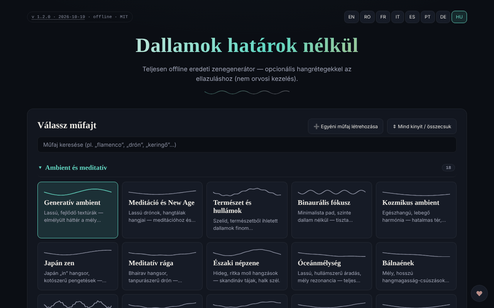

# Borderless Melodies

[English](README.md) · [Română](README.ro.md) · [Français](README.fr.md) · [Italiano](README.it.md) · [Español](README.es.md) · [Português](README.pt.md) · [Deutsch](README.de.md) · **Magyar**

**Verzió:** 1.2.1 · **Utolsó frissítés:** 2026-10-22

A felület nyelvei: **Română, English, Français, Italiano, Español, Português (PT), Deutsch, Magyar**

Eredeti zenét algoritmikusan, a böngészőben létrehozó generátor, opcionális hangrétegekkel a relaxációhoz („Relaxation waves”).

**Online:** https://chiuta.github.io/BorderlessMelodies/

## Mi ez

A Borderless Melodies („Határtalan dallamok”) egyetlen HTML-fájl, amely valós időben szintetizál zenét a Web Audio segítségével: nincsenek minták vagy felvételek, csak procedurális szintézis. Kiválasztasz egy műfajt, egy seedet és egy időtartamot, az alkalmazás pedig megkomponálja a dallamot, a kíséretet és a basszust, amelyeket meghallgathatsz vagy exportálhatsz.

## Funkciók

- Műfajválasztás listából és saját műfajok szerkesztője („Create custom genre”: skála, akkordmenet, ütem 4/4, 3/4, 5/4, 7/4, tempó, vezetődallam, pad/akkordok, basszus, textúra, szűrő, zengetés, haladó beállítások); a műfajok a „My Genres” alatt mentődnek, és exportálhatók/importálhatók (JSON).
- Komponálás: Seed („Randomize” gombbal), Tempo, „Variety & arc”, Duration (2, 5, 10, 20 perc vagy folyamatos ismétlés), „Regenerate”.
- „Relaxation waves”: kiegészítő réteg Pure tone, Binaural vagy Isochronic módban, vivőfrekvenciával, lebegési frekvenciával és keveréssel. Az alkalmazás jelzi, hogy ezeket kizárólag relaxációra kínálja, nem orvosi kezelésként, és figyelmeztetéseket tartalmaz (epilepszia, terhesség, vezetés).
- „Human voice”: szöveg nélküli énekhang-réteg, formánsokkal szintetizálva, többféle karakterrel (gyermek, tinédzser, felnőtt, idős, dallamos robotikus).
- „Gong & conch”: szintetizált gong és kagylókürt, kézzel vagy automatikusan, az elején/végén is megszólaltatható.
- **Automatikus leállítás (alvás):** a Play megnyomásától számított 15, 30, 45, 60 vagy 90 perc elteltével a hangerő 15 másodperc alatt lecsökken, és a lejátszás leáll (a visszaszámlálás szüneteltetés közben is folytatódik; a Stop megszakítja); az érték része a beállítások JSON-exportjának/-importjának (`sleepMin`).
- Lejátszás Play/Stop gombbal, hangerővel és teljes képernyős fraktálvizualizálóval (2D/3D).
- WAV vagy FLAC hangexport (1–20 perc), a beállítások exportja/importja (JSON), a seedhez kötött generatív borító (PNG/WebP/JPEG), a vizualizáló WebM-videóexportja.
- 8 nyelvű felület: EN, RO, FR, IT, ES, PT, DE, HU.

## Új funkciók (v1.1.0)

- **Mentett munkamenetek**: a műfaj, a seed, a tempó, az időtartam, az időzítő és az elhalkulás időtartama egy név alatt megőrződik (legfeljebb 30; azonos név, kis- és nagybetű megkülönböztetése nélkül, felülírja a meglévőt). Betöltés és törlés a listából; helyben tárolva, és szerepel a `.fff.json` másolatban. A `localStorage` sérült adatai üres listát eredményeznek, hiba nélkül.
- **QR-kód / hivatkozás**: az aktuális munkamenet QR-kóddá (és `#…` részt tartalmazó hivatkozássá) alakul, amelyet egy másik példány képből, beillesztett szövegből vagy hivatkozásból be tud olvasni. A megnyitott hivatkozás **nem indítja el automatikusan a hangot**. A határokon kívüli értékek korlátozásra kerülnek, az ismeretlen műfajok elutasításra; az egyéni műfajok nem osztódnak meg.
- **Beállítható elhalkulás az automatikus leállításkor** (alapértelmezés szerint 15 mp, 1 perc, 5 perc, 10 perc): a hangerő fokozatosan csökken az időzítő utolsó másodperceiben, a tesztekben valós időben ellenőrizve.
- **Kit**: Átláthatóság és `.fff.json` másolat (`core, label, bundle, qr`).
- **Nyelvek és fordítások**: az új szövegek az alkalmazás 8 nyelvén érhetők el (RO, EN, FR, IT, ES, PT, DE, HU). Az FR/IT/ES/PT/DE/HU fordítások automatikusak, és **anyanyelvi beszélők nem ellenőrizték őket**; a kit párbeszédablaka 8 nyelvű.

## Használati útmutató

1. Válaszd ki a nyelvet az EN / RO / FR / IT / ES / PT / DE / HU gombokkal.
2. Válassz műfajt (vagy „Create custom genre”, állítsd be, és nyomd meg a „Save” gombot).
3. Állítsd be a Seedet (vagy 🎲 Randomize), a Tempót és a Duration értéket.
4. Opcionálisan: kapcsold be a „Relaxation waves”, a „Human voice” vagy a gong/kagylókürt funkciót.
5. Nyomd meg a ▶ Play gombot; a Szóköz indítja/leállítja a lejátszást (ha a fókusz nem mezőn vagy gombon van).
6. A fraktálvizualizálóban: a `+` / `=` nagyít, a `-` / `_` kicsinyít, a `0` visszaállít, az Esc bezár.
7. Az „Export” alatt válaszd ki az időtartamot és a formátumot (WAV vagy FLAC), majd nyomd meg az „Export audio” gombot.
8. A konfiguráció megőrzéséhez: „Export settings (JSON)”, később „Import settings”; ugyanígy „Export my genres” / „Import genres”.
9. A „Generate cover” létrehozza a borítót, majd „Export PNG” (vagy WebP/JPEG). A „Record video” valós időben rögzít (egy 20 perces klip 20 percig tart).

## Adatvédelem és hálózat

- A „határtalan” kit (`fff-kit`, `core, label, bundle, qr` modulok) be van illesztve az `index.html` fájlba: nem küld hálózati kéréseket. Az „Átláthatóság” ablak (kattintás a verzióra) megmutatja a deklarált hálózatot (0 külső kérés), a `localStorage` kulcsait, a fájl SHA-256 értékét, és `.fff.json` biztonsági másolatot kínál (opcionálisan jelszóval titkosítva, AES-GCM). A QR-kódokat helyben állítja elő és olvassa be; az olvasás csak a felhasználó által választott képből történik, kamera nélkül.

- Az alkalmazás nem használ `localStorage`-ot, `sessionStorage`-ot vagy IndexedDB-t: a munkamenetek között semmi sem marad meg; csak az exportált fájlokon keresztül mentesz.
- Nem küld hálózati kéréseket (nincs `fetch`, CDN vagy külső szkript); az oldal szigorú CSP-szabályzattal rendelkezik (`default-src 'none'`, a szkript csak `sha256` hash alapján engedélyezett, a szkriptekhez `'unsafe-inline'` nélkül; beágyazott stílus, képek és hang csak `data:`/`blob:`). Csak hivatkozásokat tartalmaz, kattintásra megnyíló linkekkel a trom.tf és a Buy Me a Coffee felé.

## Figyelmeztetés

Tájékoztató/élményalapú tartalom. A „Relaxation waves” réteg (tiszta, binaurális, izokron hangok) kizárólag relaxációra szolgál, nem orvosi kezelés, és nem helyettesíti az orvosi tanácsot; a binaurális/izokron ritmusok hatásaira vonatkozó tudományos bizonyítékok korlátozottak. Epilepszia, más neurológiai betegség vagy terhesség esetén orvosi jóváhagyás nélkül nem ajánlott; vezetés közben ne hallgasd; hagyd abba, ha kellemetlenséget érzel; használj alacsony hangerőt. A figyelmeztetés megjelenik az alkalmazásban („Relaxation waves” panel) és az oldal láblécében.

## Futtatás helyben / offline

Töltsd le az `index.html` fájlt, és nyisd meg a böngészőben; teljesen internet nélkül működik.

## Licenc

MIT — lásd a LICENSE fájlt

## Audit

2026-10-10: ellenőrizve, hogy a kódban nincs `fetch`, XHR, WebSocket vagy külső erőforrás (0 hálózati kérés a böngészőben), és hogy nem használ helyi tárolást. Az oldalnak nincs CSP-szabályzata (meta). Javítva: hozzáférhető nevek a kapcsolókhoz/választókhoz, kontraszt, figyelmeztető megjegyzés a láblécben.

## Szerző

Alexio — Alexandru-Ionuț Chiuță, kapcsolat: alexio@trom.tf

## Előzmények / Changelog

- 1.2.1 — 2026-10-22: **javítás**: az orvosi figyelmeztetés, a teljes képernyős vizualizáló súgószövege és a felső sáv ARIA-címkéje mostantól mind a nyolc nyelven le van fordítva.
- 1.1.0 — 2026-10-14: mentett munkamenetek, QR/hivatkozás a munkamenethez, beállítható elhalkulás, „határtalan” kit. Tesztek: `tests/fff-r8.test.mjs`.
- **1.0.4 — 2026-10-12:** a verzió és az utolsó frissítés dátuma megjelenik az alkalmazásban
- **1.0.3 — 2026. október 11.:** automatikus világos téma (`prefers-color-scheme: light`; a sötét téma marad az alapértelmezett) és nyomtatási stíluslap; Chromiumban világos és sötét sémával ellenőrizve (axe 0 hiba 1280×800 és 360×740 méretnél), valamint tényleges lejátszással (a Play után az állapot „Playing” lesz, az audiokontextus a felhasználói mozdulatra indul).
- **1.0.2 — 2026. október 11.:** automatikus leállítás (alvás) 15 mp-es elhalkulással, amely része az exportált/importált beállításoknak (az ismeretlen értékeket az import figyelmen kívül hagyja); a Solfeggio-frekvenciák címkéi mostantól a felület nyelvén jelennek meg (korábban FR/IT/ES/PT/DE nyelven angolul szerepeltek); CSP `sha256` hash-sel a szkripthez (a `script-src`-ben `'unsafe-inline'` nélkül); az új szövegek a 7 nyelven érhetők el; aktív CSP mellett tesztelve (0 hiba), axe-core 0 hiba 1280×800 és 360×740 méretnél.

- **1.0.1 — 2026. október 11.:** a hangexport jobban reprodukálható: a zaj, a zengetés, a gong és a kagylókürt exportáláskor a seedből származtatott álvéletlen-generátort használ (korábban `Math.random`-ot használtak). Fennmaradó korlát: két azonos beállítású export a minták ~0,05%-ában még ±1 LSB-vel eltér (1 percnyi hanganyagon mérve), tehát nem bitre azonosak, a böngésző hangmotorjának lebegőpontos aritmetikája miatt.
- A „Solfeggio” frekvenciák alatt 7 nyelvű megjegyzés jelent meg: a címkék (felszabadulás, regeneráció, harmónia…) hagyományos/ezoterikus tulajdonítások, tudományos bizonyíték nélkül; ugyanígy az agyhullámok nevei is tájékoztató jellegűek.
- Biztonság/akadálymentesség: hozzáadva egy CSP-meta (`default-src 'none'`), `region` landmarkok a felső sávhoz és a mini lejátszóhoz; axe-core 0 hiba 1280×800 és 360×740 méretnél. A beállításfájl (JSON) formátuma importkompatibilitás miatt `version: 1.0` marad.
