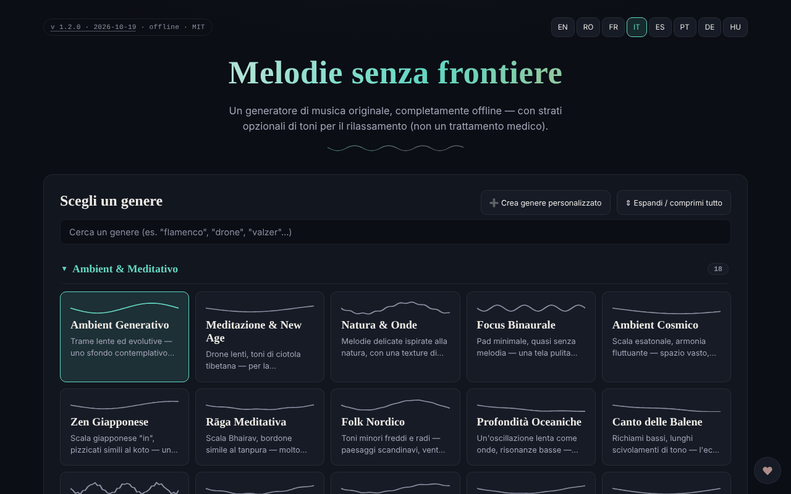

# Borderless Melodies

[English](README.md) · [Română](README.ro.md) · [Français](README.fr.md) · **Italiano** · [Español](README.es.md) · [Português](README.pt.md) · [Deutsch](README.de.md) · [Magyar](README.hu.md)

**Versione:** 2.1.1 · **Ultimo aggiornamento:** 2026-10-31

**Stato:** stabile · **Offline:** completo

Lingue dell'interfaccia: **Română, English, Français, Italiano, Español, Português (PT), Deutsch, Magyar**

Generatore di musica originale, creata algoritmicamente nel browser, con strati facoltativi di toni per il rilassamento («Relaxation waves»).

**Online:** https://chiuta.github.io/BorderlessMelodies/

## Che cos'è

Borderless Melodies («Melodie senza frontiere») è un unico file HTML che sintetizza musica in tempo reale tramite Web Audio: senza campioni né registrazioni, solo sintesi procedurale. Scegli un genere, un seed e una durata, e l'applicazione compone la melodia, l'accompagnamento e il basso, che puoi ascoltare o esportare.

## Funzioni

- Scelta del genere da un elenco ed editor di generi personalizzati («Create custom genre»: scala, progressione, metro 4/4, 3/4, 5/4, 7/4, tempo, melodia principale, pad/accordi, basso, tessitura, filtro, riverbero, opzioni avanzate); i generi vengono salvati in «My Genres» e possono essere esportati/importati (JSON).
- Composizione: Seed (con «Randomize»), Tempo, «Variety & arc», Duration (2, 5, 10, 20 min o ciclo continuo), «Regenerate».
- «Relaxation waves»: strato ausiliario nelle modalità Pure tone, Binaural o Isochronic, con frequenza portante, frequenza di battimento e mix. L'applicazione precisa che sono offerte solo per il rilassamento, non come trattamento medico, e contiene avvertenze (epilessia, gravidanza, guida).
- «Human voice»: strato vocale senza parole, sintetizzato tramite formanti, con diversi caratteri (bambino, adolescente, adulto, anziano, robotico melodioso).
- «Gong & conch»: gong e conchiglia sintetizzati, attivabili manualmente o automaticamente all'inizio/alla fine.
- **Arresto automatico (sonno):** dopo 15, 30, 45, 60 o 90 minuti da Play, il volume scende in 15 secondi e la riproduzione si ferma (il conto alla rovescia continua anche in pausa; Stop lo annulla); il valore rientra nell'esportazione/importazione delle impostazioni JSON (`sleepMin`).
- Riproduzione con Play/Stop, volume e visualizzatore frattale a schermo intero (2D/3D).
- Esportazione audio WAV o FLAC (1-20 min), esportazione/importazione delle impostazioni (JSON), copertina generativa (PNG/WebP/JPEG) legata al seed, esportazione video WebM del visualizzatore.
- Interfaccia in 8 lingue: EN, RO, FR, IT, ES, PT, DE, HU.

## Nuove funzioni (v1.1.0)

- **Sessioni salvate**: genere, seed, tempo, durata, timer e durata della dissolvenza vengono conservati con un nome (massimo 30; lo stesso nome, senza distinzione tra maiuscole e minuscole, sovrascrive). Caricamento ed eliminazione dall'elenco; memorizzate in locale e incluse nella copia `.fff.json`. Dati danneggiati in `localStorage` producono un elenco vuoto, senza errori.
- **Codice QR / link**: la sessione corrente diventa un codice QR (e un link con `#…`) che un'altra istanza può leggere da un'immagine, da un testo incollato o da un link. Un link aperto **non avvia il suono** automaticamente. I valori fuori limite vengono limitati, i generi sconosciuti respinti; i generi personalizzati non vengono condivisi.
- **Dissolvenza configurabile all'arresto automatico** (15 s predefiniti, 1 min, 5 min, 10 min): il volume scende progressivamente negli ultimi secondi del timer, verificato in tempo reale nei test.
- **Kit**: Trasparenza e copia `.fff.json` (`core, label, bundle, qr`).
- **Lingue e traduzioni**: i nuovi testi sono nelle 8 lingue dell'applicazione (RO, EN, FR, IT, ES, PT, DE, HU). Le traduzioni FR/IT/ES/PT/DE/HU sono automatiche e **non verificate da madrelingua**; la finestra di dialogo del kit ha 8 lingue.

## Manuale d'uso

1. Scegli la lingua con i pulsanti EN / RO / FR / IT / ES / PT / DE / HU.
2. Scegli un genere (oppure «Create custom genre», configuralo e premi «Save»).
3. Imposta Seed (o 🎲 Randomize), Tempo e Duration.
4. Facoltativo: attiva «Relaxation waves», «Human voice» o il gong/la conchiglia.
5. Premi ▶ Play; la barra spaziatrice avvia/ferma la riproduzione (quando il focus non è su un campo o un pulsante).
6. Nel visualizzatore frattale: `+` / `=` ingrandisce, `-` / `_` rimpicciolisce, `0` reimposta, Esc chiude.
7. In «Export» scegli la durata e il formato (WAV o FLAC) e premi «Export audio».
8. Per conservare la configurazione: «Export settings (JSON)» e, in seguito, «Import settings»; allo stesso modo «Export my genres» / «Import genres».
9. «Generate cover» crea la copertina, poi «Export PNG» (o WebP/JPEG). «Record video» registra in tempo reale (un clip di 20 min dura 20 min).

## Privacy e rete

- Il kit «senza frontiere» (`fff-kit`, moduli `core, label, bundle, qr`) è incollato in `index.html`: non effettua richieste di rete. La finestra «Trasparenza» (clic sulla versione) mostra la rete dichiarata (0 richieste esterne), le chiavi di `localStorage`, lo SHA-256 del file e offre una copia di sicurezza `.fff.json` (facoltativamente cifrata con password, AES-GCM). I codici QR vengono generati e letti in locale; la lettura avviene solo da un'immagine scelta dall'utente, senza fotocamera.

- L'applicazione non usa `localStorage`, `sessionStorage` né IndexedDB: nulla viene conservato tra le sessioni; si salva solo tramite i file esportati.
- Non effettua richieste di rete (non ha `fetch`, CDN o script esterni); la pagina ha una policy CSP restrittiva (`default-src 'none'`, script consentito solo tramite hash `sha256`, senza `'unsafe-inline'` per gli script; stile inline, immagini e audio solo `data:`/`blob:`). Contiene solo link, aperti al clic, verso trom.tf, Buy Me a Coffee.

## Avvertenza

Contenuto informativo/esperienziale. Lo strato «Relaxation waves» (toni puri, binaurali, isocronici) è offerto solo per il rilassamento, non è un trattamento medico e non sostituisce il parere medico; le prove scientifiche sugli effetti dei ritmi binaurali/isocronici sono limitate. Non è consigliato in caso di epilessia, altra condizione neurologica o gravidanza senza l'approvazione del medico; non ascoltare durante la guida; interrompi se avverti disagio; usa un volume basso. L'avvertenza compare nell'applicazione (pannello «Relaxation waves») e nel piè di pagina.

## Esecuzione locale / offline

Scarica `index.html` e aprilo nel browser; funziona completamente senza internet.

## Licenza

MIT — vedi il file LICENSE

## Audit

2026-10-10: verificato che nel codice non esistano `fetch`, XHR, WebSocket o risorse esterne (0 richieste di rete nel browser) e che non si usi l'archiviazione locale. La pagina non ha policy CSP (meta). Corretti: nomi accessibili per interruttori/selettori, contrasto, nota di avvertenza nel piè di pagina.

## Autore

Alexio — Alexandru-Ionuț Chiuță, contatto: alexio@trom.tf

## Tonalità scelta manualmente e condivisione riproducibile (2.1.0)

**Tonalità (tonica):** selettore nel pannello «Composizione»: «Automatica (dal seed)» (predefinita, come prima) o una delle 12 toniche (Do … Si). Lo stesso brano (seed, genere, tempo) viene **trasposto** nella tonalità scelta; ritmo, melodia e resto della composizione restano identici. Il controllo dello **stile** resta la scelta/modifica del genere (scala, progressione, metro, tempo, texture). **Condivisione riproducibile:** il seed e il codice breve `BM1-…` (lo stesso brano ovunque) esistevano già; una tonalità manuale entra nel link `#bm1;…;k=…`, nel QR, nelle sessioni salvate e nelle impostazioni JSON (`rootPc`), ma **non** nel codice breve BM1 (che resta vuoto finché la tonalità non è «Automatica»). L’esportazione audio (WAV/FLAC) e MIDI esisteva già e usa la tonalità scelta.

## Vedi anche: app affini (non unite)

Queste app si sovrappongono per scopo (suono calmo per relax e sonno) ma funzionano in modo diverso e **non sono state unite**. **BorderlessMelodies** è un compositore di musica originale per genere e seed (esportazione WAV/FLAC/MIDI, codici condivisibili), con strati di rilassamento opzionali. Vedi anche: [ASMR](https://chiuta.github.io/ASMR/) — un mixer di paesaggi sonori e trigger tattili (ASMR), con scene temporali e timer di spegnimento; [CalmWaves](https://chiuta.github.io/CalmWaves/) — una composizione ambient generativa (intenzione, tavolozza tonale, densità) con codice di variante, voce sintetizzata e visualizzazioni; [Aurora](https://chiuta.github.io/Aurora/) — toni dei chakra, battiti binaurali e guida al respiro per la meditazione. Scegli in base all’esigenza: paesaggi e trigger = ASMR; brano ambient generato = CalmWaves; musica per genere/seed = BorderlessMelodies; meditazione sui chakra = Aurora.

## Cronologia / Changelog
- **2.1.0 — 2026-10-27:** selettore manuale di tonalità (tonica), riportato in link/QR/sessioni/impostazioni JSON; nota «vedi anche» (ASMR, CalmWaves, Aurora), senza fusione; righe Stato/Offline; CHANGELOG.md (precedente: v2.0.0).

- 1.2.8 — 2026-10-23: Le chiavi di archiviazione hanno ora il prefisso dell'app (`borderlessmelodies.sessions`); i dati esistenti (sessioni salvate) vengono migrati automaticamente all'avvio e le vecchie copie `.fff.json` si possono ancora importare. fff-kit 1.2.0: archiviazione senza prefisso corretta
- 1.2.6 — 2026-10-22: fff-kit 1.1.4: target touch e dimensione minima del testo
- 1.2.5 — 2026-10-22: fff-kit 1.1.2: PBKDF2 600.000 iterazioni, protezione anti-clickjacking
- 1.2.4 — 2026-10-22: le finestre bloccanti `alert()`/`confirm()` (eliminazione di un genere, errori di importazione di impostazioni e pacchetti di generi, avviso «video in corso») sono sostituite da avvisi in linea tradotti e da una conferma in linea; testo minimo di 12 px e aree tattili ≥ 24 px su mobile.
- 1.2.3 — 2026-10-22: Le etichette delle opzioni nell’editor dei generi e nell’esportazione (forme d’onda, pattern di basso e arpeggio, texture, scale, progressioni, formato audio) sono ora tradotte nelle 8 lingue e si aggiornano al cambio di lingua.
- 1.2.2 — 2026-10-22: Le etichette per i lettori di schermo (chiudi, esci, riproduci/pausa, mini-player, zoom, sessioni salvate, formato copertina e video, stop, sostieni, 2D/3D) sono ora tradotte e si aggiornano al cambio di lingua.
- 1.2.1 — 2026-10-22: **correzione**: l’avviso medico, il tooltip del visualizzatore a schermo intero e l’etichetta ARIA della barra superiore sono ora tradotti in tutte e otto le lingue.
- 1.1.0 — 2026-10-14: sessioni salvate, QR/link per la sessione, dissolvenza configurabile, kit «senza frontiere». Test: `tests/fff-r8.test.mjs`.
- **1.0.4 — 2026-10-12:** la versione e la data dell'ultimo aggiornamento sono mostrate nell'applicazione
- **1.0.3 — 11 ottobre 2026:** tema chiaro automatico (`prefers-color-scheme: light`; il tema scuro resta quello predefinito) e foglio di stile per la stampa; verificato in Chromium con schema chiaro e scuro (axe 0 violazioni a 1280×800 e 360×740) e con riproduzione effettiva (dopo Play lo stato diventa «Playing», il contesto audio parte al gesto dell'utente).
- **1.0.2 — 11 ottobre 2026:** arresto automatico (sonno) con dissolvenza di 15 s, incluso nelle impostazioni esportate/importate (i valori sconosciuti vengono ignorati all'importazione); le etichette delle frequenze Solfeggio sono ora mostrate nella lingua dell'interfaccia (prima comparivano in inglese in FR/IT/ES/PT/DE); CSP con hash `sha256` per lo script (senza `'unsafe-inline'` in `script-src`); i nuovi testi sono nelle 7 lingue; testato con CSP attiva (0 errori) e axe-core 0 violazioni a 1280×800 e 360×740.

- **1.0.1 — 11 ottobre 2026:** l'esportazione audio è più riproducibile: rumore, riverbero, gong e conchiglia usano nell'esportazione un generatore pseudocasuale derivato dal seed (prima usavano `Math.random`). Limite residuo: due esportazioni con le stesse impostazioni differiscono ancora di ±1 LSB in ~0,05% dei campioni (misurato su 1 min di audio), quindi non sono identiche bit per bit, a causa dell'aritmetica in virgola mobile del motore audio del browser.
- Sotto le frequenze «Solfeggio» è comparsa una nota in 7 lingue: le etichette (liberazione, rigenerazione, armonia…) sono attribuzioni tradizionali/esoteriche, senza prove scientifiche; allo stesso modo i nomi delle onde cerebrali sono indicativi.
- Sicurezza/accessibilità: aggiunto un meta CSP (`default-src 'none'`), punti di riferimento `region` per la barra superiore e il mini-player; axe-core 0 violazioni a 1280×800 e 360×740. Il formato del file di impostazioni (JSON) resta `version: 1.0` per la compatibilità all'importazione.
