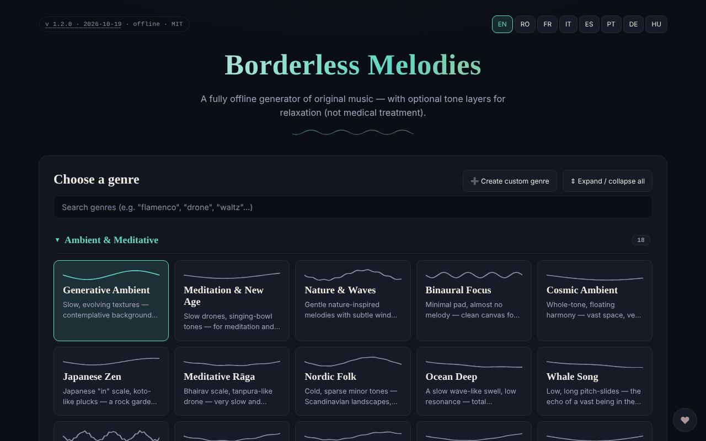

# Borderless Melodies

**English** · [Română](README.ro.md) · [Français](README.fr.md) · [Italiano](README.it.md) · [Español](README.es.md) · [Português](README.pt.md) · [Deutsch](README.de.md) · [Magyar](README.hu.md)

**Version:** 1.2.3 · **Last updated:** 2026-10-22

Interface languages: **Română, English, Français, Italiano, Español, Português (PT), Deutsch, Magyar**

A generator of original music, created algorithmically in the browser, with optional tone layers for relaxation ("Relaxation waves").

**Live:** https://chiuta.github.io/BorderlessMelodies/

## What it is

Borderless Melodies is a single HTML file that synthesises music in real time through Web Audio: no samples or recordings, only procedural synthesis. You choose a genre, a seed and a duration, and the application composes the melody, the accompaniment and the bass, which you can listen to or export.

## Features

- Choice of genre from a list and an editor for your own genres ("Create custom genre": scale, progression, metre 4/4, 3/4, 5/4, 7/4, tempo, lead melody, pad/chords, bass, texture, filter, reverb, advanced options); genres are saved in "My Genres" and can be exported/imported (JSON).
- Composition: Seed (with "Randomize"), Tempo, "Variety & arc", Duration (2, 5, 10, 20 min or continuous loop), "Regenerate".
- "Relaxation waves": an auxiliary layer in Pure tone, Binaural or Isochronic modes, with carrier frequency, beat frequency and mix. The application states that they are offered only for relaxation, not as medical treatment, and contains warnings (epilepsy, pregnancy, driving).
- "Human voice": a wordless vocal layer, synthesised through formants, with several characters (child, teenager, adult, senior, melodious robotic).
- "Gong & conch": a synthesised gong and conch, which can be triggered manually or automatically at the start/end.
- **Automatic stop (sleep):** after 15, 30, 45, 60 or 90 minutes from Play, the volume goes down over 15 seconds and playback stops (the countdown continues while paused; Stop cancels it); the value is included in the JSON settings export/import (`sleepMin`).
- Playback with Play/Stop, volume and a full-screen fractal visualiser (2D/3D).
- WAV or FLAC audio export (1-20 min), settings export/import (JSON), a generative cover (PNG/WebP/JPEG) tied to the seed, WebM video export of the visualiser.
- Interface in 8 languages: EN, RO, FR, IT, ES, PT, DE, HU.

## New features (v1.1.0)

- **Saved sessions**: the genre, seed, tempo, duration, timer and fade duration are kept under a name (maximum 30; the same name, case-insensitively, overwrites). Load and delete from the list; stored locally and included in the `.fff.json` copy. Corrupted data in `localStorage` yields an empty list, with no errors.
- **QR code / link**: the current session becomes a QR code (and a link with `#…`) that another instance can read from an image, pasted text or a link. An opened link **does not start the sound** automatically. Out-of-range values are clamped, unknown genres are rejected; custom genres are not shared.
- **Configurable fade at automatic stop** (15 s by default, 1 min, 5 min, 10 min): the volume decreases progressively in the last seconds of the timer, verified in real time in the tests.
- **Kit**: Transparency and `.fff.json` copy (`core, label, bundle, qr`).
- **Languages and translations**: The new texts are in the application's 8 languages (RO, EN, FR, IT, ES, PT, DE, HU). The FR/IT/ES/PT/DE/HU translations are automatic and **not verified by native speakers**; the kit dialog has 8 languages.

## User guide

1. Choose the language with the EN / RO / FR / IT / ES / PT / DE / HU buttons.
2. Choose a genre (or "Create custom genre", configure it and press "Save").
3. Set Seed (or 🎲 Randomize), Tempo and Duration.
4. Optionally: enable "Relaxation waves", "Human voice" or the gong/conch.
5. Press ▶ Play; Space starts/stops playback (when the focus is not on a field or button).
6. In the fractal visualiser: `+` / `=` zooms in, `-` / `_` zooms out, `0` resets, Esc closes.
7. Under "Export" choose the duration and the format (WAV or FLAC) and press "Export audio".
8. To keep the configuration: "Export settings (JSON)" and, later, "Import settings"; likewise "Export my genres" / "Import genres".
9. "Generate cover" creates the cover, then "Export PNG" (or WebP/JPEG). "Record video" records in real time (a 20-minute clip takes 20 minutes).

## Privacy and network

- The "borderless" kit (`fff-kit`, modules `core, label, bundle, qr`) is pasted into `index.html`: it makes no network requests. The "Transparency" dialog (click on the version) shows the declared network (0 external requests), the `localStorage` keys, the SHA-256 of the file and offers a `.fff.json` backup copy (optionally encrypted with a password, AES-GCM). QR codes are generated and read locally; reading is done only from an image chosen by the user, without a camera.

- The application does not use `localStorage`, `sessionStorage` or IndexedDB: nothing is retained between sessions; you save only through the exported files.
- It makes no network requests (it has no `fetch`, CDNs or external scripts); the page has a restrictive CSP policy (`default-src 'none'`, script allowed only through a `sha256` hash, without `'unsafe-inline'` for scripts; inline style, images and audio only `data:`/`blob:`). It contains only links, opened on click, to trom.tf, Buy Me a Coffee.

## Warning

Informational/experiential content. The "Relaxation waves" layer (pure, binaural, isochronic tones) is offered only for relaxation, is not medical treatment and does not replace medical advice; the scientific evidence on the effects of binaural/isochronic rhythms is limited. Not recommended in case of epilepsy, another neurological condition or pregnancy without a doctor's approval; do not listen while driving; stop if you feel discomfort; use a low volume. The warning appears in the application (the "Relaxation waves" panel) and in the page footer.

## Running locally / offline

Download `index.html` and open it in the browser; it works completely without internet.

## Licence

MIT — see the LICENSE file

## Audit

2026-10-10: verified that the code contains no `fetch`, XHR, WebSocket or external resources (0 network requests in the browser) and that no local storage is used. The page has no CSP policy (meta). Fixed: accessible names for toggles/selectors, contrast, a warning note in the footer.

## Author

Alexio — Alexandru-Ionuț Chiuță, contact: alexio@trom.tf

## History / Changelog

- 1.2.3 — 2026-10-22: Option labels in the genre editor and export (waveforms, bass and arpeggio patterns, textures, scales, progressions, audio format) are now translated into all 8 languages and update when the language changes.
- 1.2.2 — 2026-10-22: Screen-reader labels (close, exit, play/pause, mini player, zoom, saved sessions, cover and video format, stop, support, 2D/3D) are now translated and update when the language changes.
- 1.2.1 — 2026-10-22: **fix**: the medical disclaimer, the full-screen visualizer tooltip and the top-bar ARIA label are now translated into all eight languages.
- 1.1.0 — 2026-10-14: saved sessions, QR/link for the session, configurable fade, "borderless" kit. Tests: `tests/fff-r8.test.mjs`.
- **1.0.4 — 2026-10-12:** the version and the last-updated date are shown in the application
- **1.0.3 — 11 October 2026:** automatic light theme (`prefers-color-scheme: light`; the dark theme remains the default) and a print style sheet; verified in Chromium with light and dark schemes (axe 0 violations at 1280×800 and 360×740) and with actual playback (after Play the state becomes "Playing", the audio context starts on the user gesture).
- **1.0.2 — 11 October 2026:** automatic stop (sleep) with a 15 s fade, included in the exported/imported settings (unknown values are ignored on import); the Solfeggio frequency labels are now shown in the interface language (previously they appeared in English in FR/IT/ES/PT/DE); CSP with a `sha256` hash for the script (without `'unsafe-inline'` in `script-src`); the new texts are in the 7 languages; tested with CSP active (0 errors) and axe-core 0 violations at 1280×800 and 360×740.

- **1.0.1 — 11 October 2026:** audio export is more reproducible: noise, reverb, gong and conch use, at export, a pseudo-random generator derived from the seed (previously they used `Math.random`). Remaining limit: two exports with the same settings still differ by ±1 LSB in ~0.05% of samples (measured over 1 min of audio), so they are not bit-for-bit identical, because of the floating-point arithmetic of the browser's audio engine.
- A note in 7 languages appeared under the "Solfeggio" frequencies: the labels (release, regeneration, harmony…) are traditional/esoteric attributions, with no scientific evidence; likewise the names of the brain waves are indicative.
- Security/accessibility: a CSP meta was added (`default-src 'none'`), `region` landmarks for the top bar and the mini-player; axe-core 0 violations at 1280×800 and 360×740. The format of the settings file (JSON) remains `version: 1.0` for import compatibility.
