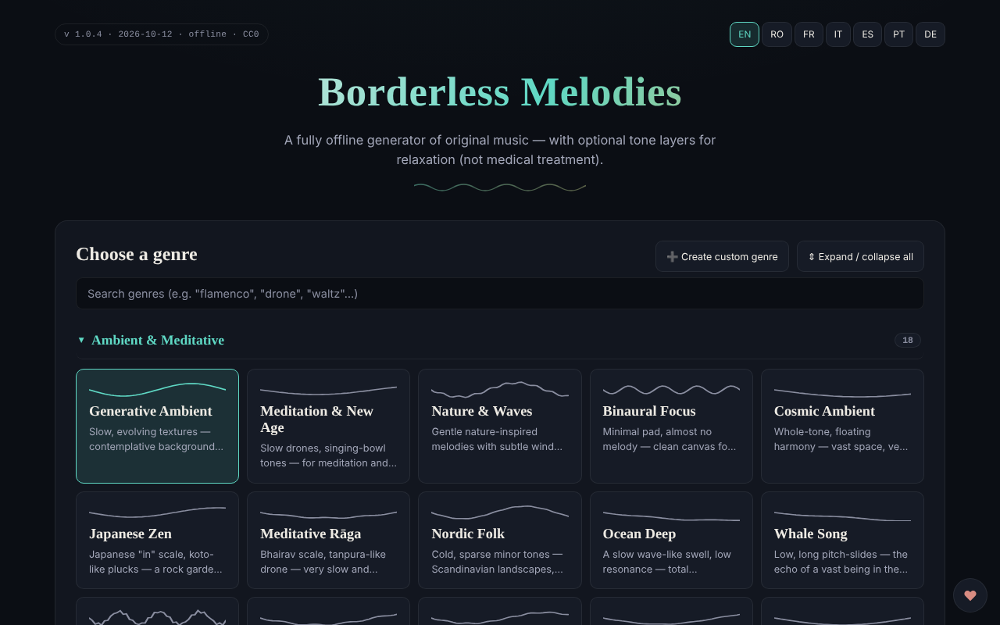

# Borderless Melodies

[English](README.md) · [Română](README.ro.md) · [Français](README.fr.md) · [Italiano](README.it.md) · [Español](README.es.md) · **Português** · [Deutsch](README.de.md) · [Magyar](README.hu.md)

**Versão:** 1.1.0 · **Última atualização:** 2026-10-14

Gerador de música original, criada algoritmicamente no navegador, com camadas opcionais de tons para relaxamento («Relaxation waves»).

**Online:** https://chiuta.github.io/BorderlessMelodies/

## O que é

O Borderless Melodies («Melodias sem fronteiras») é um único ficheiro HTML que sintetiza música em tempo real através do Web Audio: sem amostras nem gravações, apenas síntese procedimental. Escolhe um género, uma semente (seed) e uma duração, e a aplicação compõe a melodia, o acompanhamento e o baixo, que pode ouvir ou exportar.

## Funcionalidades

- Escolha do género a partir de uma lista e editor de géneros próprios («Create custom genre»: escala, progressão, compasso 4/4, 3/4, 5/4, 7/4, andamento, melodia principal, pad/acordes, baixo, textura, filtro, reverberação, opções avançadas); os géneros são guardados em «My Genres» e podem ser exportados/importados (JSON).
- Composição: Seed (com «Randomize»), Tempo, «Variety & arc», Duration (2, 5, 10, 20 min ou ciclo contínuo), «Regenerate».
- «Relaxation waves»: camada auxiliar nos modos Pure tone, Binaural ou Isochronic, com frequência portadora, frequência de batimento e mistura. A aplicação refere que são oferecidas apenas para relaxamento, não como tratamento médico, e contém avisos (epilepsia, gravidez, condução).
- «Human voice»: camada vocal sem palavras, sintetizada por formantes, com vários caráteres (criança, adolescente, adulto, idoso, robótico melodioso).
- «Gong & conch»: gongo e búzio sintetizados, acionáveis manualmente ou automaticamente no início/no fim.
- **Paragem automática (sono):** passados 15, 30, 45, 60 ou 90 minutos desde o Play, o volume baixa em 15 segundos e a reprodução pára (a contagem continua em pausa; Stop cancela-a); o valor entra na exportação/importação das definições JSON (`sleepMin`).
- Reprodução com Play/Stop, volume e visualizador fractal em ecrã inteiro (2D/3D).
- Exportação de áudio WAV ou FLAC (1-20 min), exportação/importação de definições (JSON), capa generativa (PNG/WebP/JPEG) ligada à semente, exportação de vídeo WebM do visualizador.
- Interface em 7 idiomas: EN, RO, FR, IT, ES, PT, DE.

## Novas funcionalidades (v1.1.0)

- **Sessões guardadas**: o género, a semente, o andamento, a duração, o temporizador e a duração do esbatimento são guardados com um nome (máximo 30; o mesmo nome, sem distinção entre maiúsculas e minúsculas, sobrescreve). Carregamento e eliminação a partir da lista; armazenadas localmente e incluídas na cópia `.fff.json`. Dados corrompidos em `localStorage` dão uma lista vazia, sem erros.
- **Código QR / ligação**: a sessão atual torna-se um código QR (e uma ligação com `#…`) que outra instância pode ler a partir de uma imagem, de texto colado ou de uma ligação. Uma ligação aberta **não inicia o som** automaticamente. Os valores fora dos limites são limitados, os géneros desconhecidos são rejeitados; os géneros personalizados não são partilhados.
- **Esbatimento configurável na paragem automática** (15 s por predefinição, 1 min, 5 min, 10 min): o volume diminui progressivamente nos últimos segundos do temporizador, verificado em tempo real nos testes.
- **Kit**: Transparência e cópia `.fff.json` (`core, label, bundle, qr`).
- **Idiomas e traduções**: os textos novos estão nos 7 idiomas da aplicação (RO, EN, FR, IT, ES, PT, DE); a aplicação não tem húngaro no seletor, pelo que os textos novos não têm versão em húngaro. As traduções FR/IT/ES/PT/DE são automáticas e **não foram verificadas por falantes nativos**; a caixa de diálogo do kit tem 8 idiomas.

## Manual de utilização

1. Escolha o idioma com os botões EN / RO / FR / IT / ES / PT / DE.
2. Escolha um género (ou «Create custom genre», configure-o e prima «Save»).
3. Defina Seed (ou 🎲 Randomize), Tempo e Duration.
4. Opcional: ative «Relaxation waves», «Human voice» ou o gongo/o búzio.
5. Prima ▶ Play; a barra de espaço inicia/pára a reprodução (quando o foco não está num campo ou botão).
6. No visualizador fractal: `+` / `=` aproxima, `-` / `_` afasta, `0` repõe, Esc fecha.
7. Em «Export» escolha a duração e o formato (WAV ou FLAC) e prima «Export audio».
8. Para guardar a configuração: «Export settings (JSON)» e, mais tarde, «Import settings»; do mesmo modo «Export my genres» / «Import genres».
9. «Generate cover» cria a capa, depois «Export PNG» (ou WebP/JPEG). «Record video» grava em tempo real (um clipe de 20 min demora 20 min).

## Privacidade e rede

- O kit «sem fronteiras» (`fff-kit`, módulos `core, label, bundle, qr`) está colado em `index.html`: não faz pedidos de rede. A caixa de diálogo «Transparência» (clique na versão) mostra a rede declarada (0 pedidos externos), as chaves de `localStorage`, o SHA-256 do ficheiro e oferece uma cópia de segurança `.fff.json` (opcionalmente cifrada com palavra-passe, AES-GCM). Os códigos QR são gerados e lidos localmente; a leitura faz-se apenas a partir de uma imagem escolhida pelo utilizador, sem câmara.

- A aplicação não utiliza `localStorage`, `sessionStorage` nem IndexedDB: nada é retido entre sessões; só guarda através dos ficheiros exportados.
- Não faz pedidos de rede (não tem `fetch`, CDN nem scripts externos); a página tem uma política CSP restritiva (`default-src 'none'`, script permitido apenas por hash `sha256`, sem `'unsafe-inline'` para scripts; estilo inline, imagens e áudio apenas `data:`/`blob:`). Contém apenas ligações, abertas ao clicar, para trom.tf, Buy Me a Coffee.

## Aviso

Conteúdo informativo/experiencial. A camada «Relaxation waves» (tons puros, binaurais, isocrónicos) é oferecida apenas para relaxamento, não é tratamento médico e não substitui o aconselhamento médico; as provas científicas sobre os efeitos dos ritmos binaurais/isocrónicos são limitadas. Não é recomendada em caso de epilepsia, outra afeção neurológica ou gravidez sem o acordo do médico; não ouça durante a condução; pare se sentir desconforto; use um volume baixo. O aviso aparece na aplicação (painel «Relaxation waves») e no rodapé da página.

## Execução local / offline

Descarregue `index.html` e abra-o no navegador; funciona completamente sem internet.

## Licença

MIT — ver o ficheiro LICENSE

## Auditoria

2026-10-10: verificado que no código não existem `fetch`, XHR, WebSocket nem recursos externos (0 pedidos de rede no navegador) e que não se utiliza armazenamento local. A página não tem política CSP (meta). Corrigidos: nomes acessíveis para interruptores/seletores, contraste, nota de aviso no rodapé.

## Autor

Alexio — Alexandru-Ionuț Chiuță, contacto: alexio@trom.tf

## Histórico / Changelog

- 1.1.0 — 2026-10-14: sessões guardadas, QR/ligação para a sessão, esbatimento configurável, kit «sem fronteiras». Testes: `tests/fff-r8.test.mjs`.
- **1.0.4 — 2026-10-12:** a versão e a data da última atualização são apresentadas na aplicação
- **1.0.3 — 11 de outubro de 2026:** tema claro automático (`prefers-color-scheme: light`; o tema escuro continua a ser o predefinido) e folha de estilo de impressão; verificado no Chromium com esquema claro e escuro (axe 0 violações a 1280×800 e 360×740) e com reprodução efetiva (após Play o estado passa a «Playing», o contexto de áudio arranca com o gesto do utilizador).
- **1.0.2 — 11 de outubro de 2026:** paragem automática (sono) com esbatimento de 15 s, incluída nas definições exportadas/importadas (os valores desconhecidos são ignorados na importação); as etiquetas das frequências Solfeggio são agora apresentadas no idioma da interface (antes apareciam em inglês em FR/IT/ES/PT/DE); CSP com hash `sha256` para o script (sem `'unsafe-inline'` em `script-src`); os textos novos estão nos 7 idiomas; testado com CSP ativa (0 erros) e axe-core 0 violações a 1280×800 e 360×740.

- **1.0.1 — 11 de outubro de 2026:** a exportação de áudio é mais reprodutível: o ruído, a reverberação, o gongo e o búzio usam na exportação um gerador pseudoaleatório derivado da semente (antes usavam `Math.random`). Limite restante: duas exportações com as mesmas definições ainda diferem em ±1 LSB em ~0,05% das amostras (medido em 1 min de áudio), pelo que não são idênticas bit a bit, devido à aritmética de vírgula flutuante do motor de áudio do navegador.
- Por baixo das frequências «Solfeggio» surgiu uma nota em 7 idiomas: as etiquetas (libertação, regeneração, harmonia…) são atribuições tradicionais/esotéricas, sem provas científicas; do mesmo modo, os nomes das ondas cerebrais são indicativos.
- Segurança/acessibilidade: foi adicionado um meta CSP (`default-src 'none'`), marcos `region` para a barra superior e o mini-leitor; axe-core 0 violações a 1280×800 e 360×740. O formato do ficheiro de definições (JSON) continua a ser `version: 1.0` por compatibilidade na importação.
