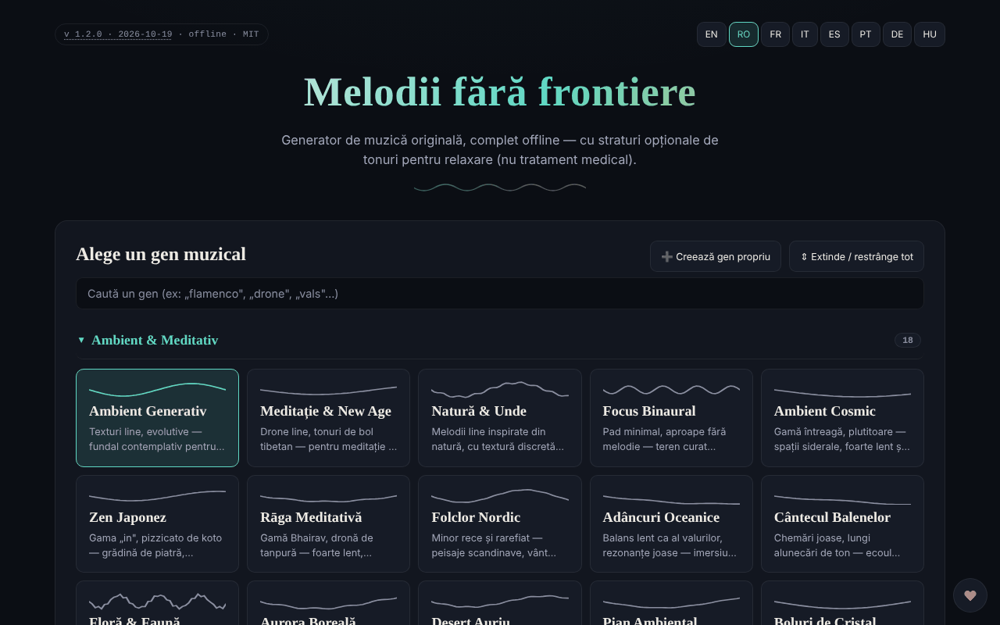

# Borderless Melodies

[English](README.md) · **Română** · [Français](README.fr.md) · [Italiano](README.it.md) · [Español](README.es.md) · [Português](README.pt.md) · [Deutsch](README.de.md) · [Magyar](README.hu.md)

**Versiune:** 2.0.0 · **Ultima actualizare:** 2026-10-26

Limbile interfeței: **Română, English, Français, Italiano, Español, Português (PT), Deutsch, Magyar**

Generator de muzică originală, creată algoritmic în browser, cu straturi opționale de tonuri pentru relaxare („Relaxation waves").

**Live:** https://chiuta.github.io/BorderlessMelodies/

## Ce este

Borderless Melodies („Melodii fără frontiere") este un fișier HTML unic care sintetizează muzică în timp real prin Web Audio: fără mostre sau înregistrări, doar sinteză procedurală. Alegi un gen, un seed și o durată, iar aplicația compune melodia, acompaniamentul și basul, pe care le poți asculta sau exporta.

## Funcții

- Alegere de gen dintr-o listă și editor de genuri proprii („Create custom genre": scară, progresie, metrică 4/4, 3/4, 5/4, 7/4, tempo, melodie lead, pad/acorduri, bas, textură, filtru, reverb, opțiuni avansate); genurile se salvează în „My Genres" și se pot exporta/importa (JSON).
- Compoziție: Seed (cu „Randomize"), Tempo, „Variety & arc", Duration (2, 5, 10, 20 min sau buclă continuă), „Regenerate".
- „Relaxation waves": strat auxiliar în modurile Pure tone, Binaural sau Isochronic, cu frecvență purtătoare, frecvență de bătaie și mixaj. Aplicația precizează că sunt oferite doar pentru relaxare, nu ca tratament medical, și conține avertismente (epilepsie, sarcină, condus).
- „Human voice": strat vocal fără cuvinte, sintetizat prin formanți, cu mai multe caractere (copil, adolescent, adult, senior, robotic melodios).
- „Gong & conch": gong și scoică sintetizate, apelabile manual sau automat la început/sfârșit.
- **Oprire automată (somn):** după 15, 30, 45, 60 sau 90 de minute de la Play, volumul coboară în 15 secunde și redarea se oprește (numărătoarea continuă și în pauză; Stop o anulează); valoarea intră în exportul/importul setărilor JSON (`sleepMin`).
- Redare cu Play/Stop, volum și vizualizator fractal pe ecran complet (2D/3D).
- Export audio WAV sau FLAC (1-20 min), export/import setări (JSON), copertă generativă (PNG/WebP/JPEG) legată de seed, export video WebM al vizualizatorului.
- Interfață în 8 limbi: EN, RO, FR, IT, ES, PT, DE, HU.

## Funcții noi (v2.0.0)

- **Cod scurt de piesă**: genul, sămânța, tempoul, durata, varietatea și vocea se condensează într-un cod de forma `BM1-XXXX-XXXX-XXXX` (cu sumă de control). Același cod produce aceeași melodie în orice browser; se aplică și dintr-un link `#code=BM1-…`, fără a porni sunetul. Genurile personalizate nu au cod.
- **Export MIDI**: aceeași partitură generativă (pad, bas, melodie, arpegiu și, dacă e activată, voce) se salvează ca fișier MIDI standard (tip 1, 480 PPQ) cu tempo și măsură, pe baza duratei alese la export. Aceeași sămânță dă același fișier.
- Neimplementat: scale din muzici ale lumii adăugate separat și acompaniamentul în timp real.

## Funcții noi (v1.1.0)

- **Sesiuni salvate**: se păstrează sub un nume genul, sămânța, tempoul, durata, temporizatorul și durata estompării (maximum 30; același nume, fără diferență de litere, suprascrie). Încărcare și ștergere din listă; stocate local și incluse în copia `.fff.json`. Date corupte în `localStorage` dau listă goală, fără erori.
- **Cod QR / link**: sesiunea curentă devine un cod QR (și link cu `#…`) pe care îl poate citi altă instanță din imagine, text lipit sau link. Un link deschis **nu pornește sunetul** automat. Valorile din afara limitelor sunt limitate, genurile necunoscute respinse; genurile personalizate nu se partajează.
- **Estompare configurabilă la oprirea automată** (15 s implicit, 1 min, 5 min, 10 min): volumul scade progresiv în ultimele secunde ale temporizatorului, verificat în timp real în teste.
- **Kit**: Transparență și copie `.fff.json` (`core, label, bundle, qr`).
- **Limbi și traduceri**: Textele noi sunt în cele 8 limbi ale aplicației (RO, EN, FR, IT, ES, PT, DE, HU). Traducerile FR/IT/ES/PT/DE/HU sunt automate și **neverificate de vorbitori nativi**; dialogul kitului are 8 limbi.

## Manual de utilizare

1. Alege limba din butoanele EN / RO / FR / IT / ES / PT / DE / HU.
2. Alege un gen (sau „Create custom genre", configurezi și apeși „Save").
3. Setează Seed (sau 🎲 Randomize), Tempo și Duration.
4. Opțional: activează „Relaxation waves", „Human voice" sau gongul/scoica.
5. Apasă ▶ Play; Space pornește/oprește redarea (când focusul nu e pe un câmp sau buton).
6. În vizualizatorul fractal: `+` / `=` apropie, `-` / `_` depărtează, `0` resetează, Esc închide.
7. La „Export" alege durata și formatul (WAV sau FLAC) și apasă „Export audio".
8. Pentru a păstra configurația: „Export settings (JSON)" și, ulterior, „Import settings"; la fel „Export my genres" / „Import genres".
9. „Generate cover" creează coperta, apoi „Export PNG" (sau WebP/JPEG). „Record video" înregistrează în timp real (un clip de 20 min durează 20 min).

## Confidențialitate și rețea

- Kitul „fără frontiere” (`fff-kit`, modulele `core, label, bundle, qr`) este lipit în `index.html`: nu face cereri de rețea. Dialogul „Transparență” (clic pe versiune) arată rețeaua declarată (0 cereri externe), cheile din `localStorage`, SHA-256 al fișierului și oferă copie de siguranță `.fff.json` (opțional criptată cu parolă, AES-GCM). Codurile QR se generează și se citesc local; citirea se face doar dintr-o imagine aleasă de utilizator, fără cameră.

- Aplicația nu folosește `localStorage`, `sessionStorage` sau IndexedDB: nimic nu este reținut între sesiuni; salvezi doar prin fișierele exportate.
- Nu efectuează cereri de rețea (nu are `fetch`, CDN-uri sau scripturi externe); pagina are o politică CSP restrictivă (`default-src 'none'`, script permis doar prin hash `sha256`, fără `'unsafe-inline'` la scripturi; stil inline, imagini și audio doar `data:`/`blob:`). Conține doar link-uri, deschise la click, către trom.tf, Buy Me a Coffee.

## Avertisment

Conținut informativ/experiențial. Stratul „Relaxation waves" (tonuri pure, binaurale, izocronice) este oferit doar pentru relaxare, nu este tratament medical și nu înlocuiește sfatul medical; dovezile științifice privind efectele ritmurilor binaurale/izocronice sunt limitate. Nu este recomandat în caz de epilepsie, altă afecțiune neurologică sau sarcină fără acordul medicului; nu asculta în timpul condusului; oprește dacă simți disconfort; folosește volum redus. Avertismentul apare în aplicație (panoul „Relaxation waves") și în subsolul paginii.

## Rulare locală / offline

Descarcă `index.html` și deschide-l în browser; funcționează complet fără internet.

## Licență

MIT — vezi fișierul LICENSE

## Audit

2026-10-10: verificat că în cod nu există `fetch`, XHR, WebSocket sau resurse externe (0 cereri de rețea în browser) și că nu se folosește stocare locală. Pagina nu are politică CSP (meta). Corectate: nume accesibile pentru comutatoare/selectoare, contrast, notă de avertisment în subsol.

## Autor

Alexio — Alexandru-Ionuț Chiuță, contact: alexio@trom.tf

## Rezumat

Borderless Melodies este un generator într-un singur fișier HTML de muzică originală sintetizată procedural în browser (Web Audio), cu genuri personalizate, straturi binaurale/izocronice opționale, o voce sintetizată fără cuvinte, gong și cochilie, un vizualizator fractal și export în WAV/FLAC, copertă și video WebM. 8 limbi de interfață. Nu stochează nimic și nu face cereri de rețea.

## Istoric / Changelog

- 1.2.8 — 2026-10-23: Cheile de stocare au acum prefixul aplicației (`borderlessmelodies.sessions`); datele existente (sesiunile salvate) se migrează automat la pornire, iar copiile vechi `.fff.json` se pot importa în continuare. fff-kit 1.2.0: stocare fără prefix remediată
- 1.2.6 — 2026-10-22: fff-kit 1.1.4: ținte tactile și text minim
- 1.2.5 — 2026-10-22: fff-kit 1.1.2: PBKDF2 600 000 iterații, protecție anti-clickjacking
- 1.2.4 — 2026-10-22: dialogurile blocante `alert()`/`confirm()` (ștergerea unui gen, erori la importul de setări și de pachete de genuri, avertismentul „video în curs”) sunt înlocuite cu notificări inline traduse și o confirmare inline; text minim 12 px și ținte tactile ≥ 24 px pe mobil.
- 1.2.3 — 2026-10-22: Etichetele opțiunilor din editorul de genuri și din export (forme de undă, tipare de bas și arpegiu, texturi, game, progresii, format audio) sunt acum traduse în toate cele 8 limbi și se actualizează la schimbarea limbii.
- 1.2.2 — 2026-10-22: Etichetele pentru cititoarele de ecran (închide, ieșire, redare/pauză, mini-player, zoom, sesiuni salvate, format copertă și video, oprește, susține, 2D/3D) sunt acum traduse și se actualizează la schimbarea limbii.
- 1.2.1 — 2026-10-22: **remediere**: avertismentul medical, tooltip-ul vizualizatorului pe tot ecranul și eticheta ARIA a barei de sus sunt acum traduse în toate cele opt limbi.
- 1.1.0 — 2026-10-14: sesiuni salvate, QR/link pentru sesiune, estompare configurabilă, kit „fără frontiere”. Teste: `tests/fff-r8.test.mjs`.
- **1.0.4 — 2026-10-12:** versiunea și data ultimei actualizări sunt afișate în aplicație
- **1.0.3 — 11 octombrie 2026:** temă deschisă automată (`prefers-color-scheme: light`; tema întunecată rămâne implicită) și foaie de stil pentru tipărire; verificat în Chromium cu schemă luminoasă și întunecată (axe 0 violări la 1280×800 și 360×740) și cu redare efectivă (după Play starea devine „Playing”, contextul audio pornește la gestul utilizatorului).
- **1.0.2 — 11 octombrie 2026:** oprire automată (somn) cu estompare de 15 s, inclusă în setările exportate/importate (valorile necunoscute sunt ignorate la import); etichetele frecvențelor Solfeggio sunt acum afișate în limba interfeței (înainte apăreau în engleză în FR/IT/ES/PT/DE); CSP cu hash `sha256` pentru script (fără `'unsafe-inline'` la `script-src`); textele noi sunt în cele 7 limbi; testat cu CSP activ (0 erori) și axe-core 0 violări la 1280×800 și 360×740.

- **1.0.1 — 11 octombrie 2026:** exportul audio este mai reproductibil: zgomotul, reverb-ul, gongul și scoica folosesc la export un generator pseudo-aleator derivat din seed (înainte foloseau `Math.random`). Limită rămasă: două exporturi cu aceleași setări diferă încă cu ±1 LSB în ~0,05% din eșantioane (măsurat la 1 min de audio), deci nu sunt bit-cu-bit identice, din cauza aritmeticii în virgulă mobilă a motorului audio al browserului.
- Sub frecvențele „Solfeggio” a apărut o notă în 7 limbi: etichetele (eliberare, regenerare, armonie…) sunt atribuiri tradiționale/ezoterice, fără dovezi științifice; la fel numele undelor cerebrale sunt orientative.
- Securitate/accesibilitate: meta CSP adăugat (`default-src 'none'`), repere `region` pentru bara de sus și mini-playerul; axe-core 0 violări la 1280×800 și 360×740. Formatul fișierului de setări (JSON) rămâne `version: 1.0` pentru compatibilitate la import.
